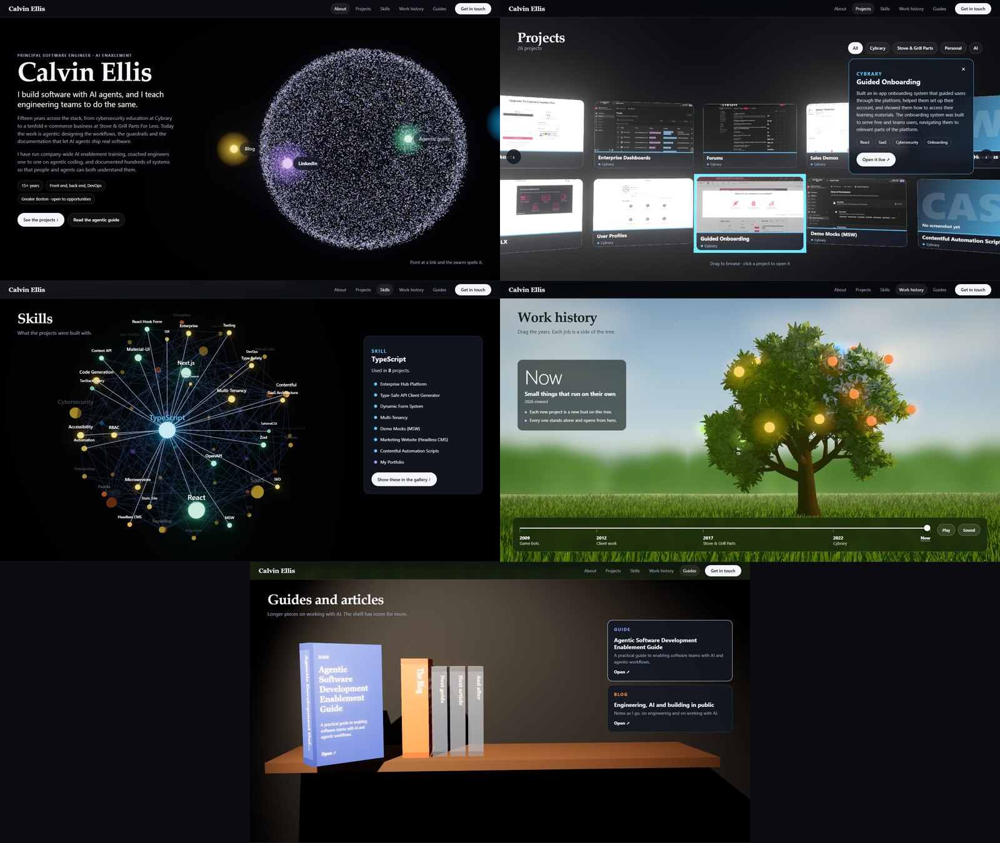
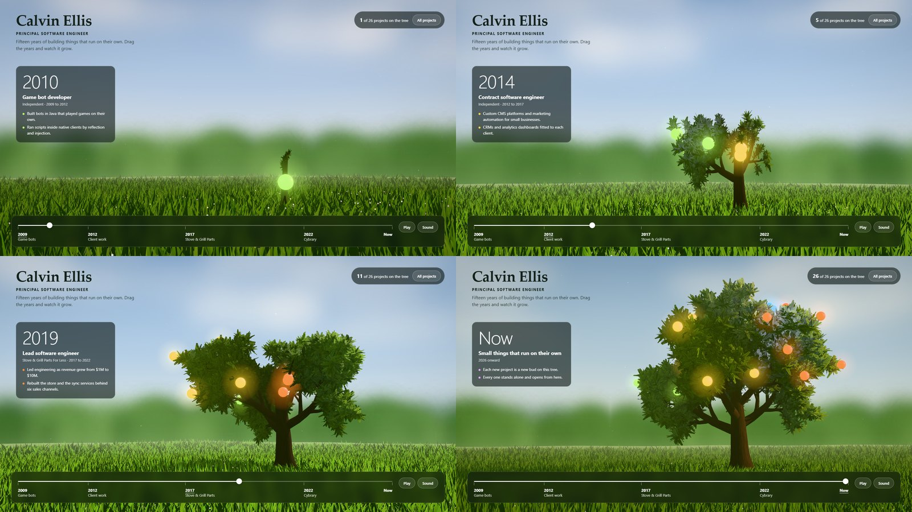

# 3D portfolio: concepts

Brainstorm for remaking calvinellis.io as a 3D experience. **The current direction is the
sectioned page**, a working prototype in [../prototypes/site/](../prototypes/site/): the
current site's sections, each as its own 3D piece. The career tree is its work history
section. Round two below is six other ways to show a lot of projects. Its pictures are rough live
mockups in three.js, in [concept-mockups/](concept-mockups/). They show the idea, not the
final art.

- [The brief](#the-brief)
- [The sectioned page](#the-sectioned-page)
- [The bar, and the career tree](#the-bar-and-the-career-tree)
- [The four jobs](#the-four-jobs)
- [The six, side by side](#the-six-side-by-side)
- [Concepts](#concepts)
- [Recommendation](#recommendation)
- [Rules for whichever one wins](#rules-for-whichever-one-wins)
- [First milestone](#first-milestone)
- [What already exists](#what-already-exists)
- [Round one, set aside](#round-one-set-aside)
- [Repo gaps found while reading](#repo-gaps-found-while-reading)

## The brief

Owner, 2026-11-11, after round one.

- **Projects come first.** There are a lot of them and the list keeps growing: many small
  standalone things, each hosted on its own and linked from here.
- **A work history timeline** sits somewhere in it.
- **It still answers two questions**: who is this, and what has he done.
- **Original.** Round one toured a career, and none of the seven landed.

## The sectioned page

Owner, 2026-11-11, after the career tree: not the tree as the whole site. The current site
has the right sections, and each one should be its own 3D piece.

| Section | What he asked for | What the prototype does |
|---|---|---|
| About | Decent as it is. Rework it to be more AI focused, and be creative with the social links | New copy that leads with agentic work. A particle swarm with the links in orbit; point at one and the swarm spells it |
| Projects | The biggest part: a showcase for a lot of projects | A curved wall of project screens with the real screenshots, filters, and a card with the story and links |
| Skills | He likes the section. Something creative in 3D | A globe of every skill, sized by use, joined where skills were used together. A skill filters the gallery |
| Work history | Could be its own 3D experience | The career tree, with the years on a slider |
| Guides and articles | A way to link them | Books on a shelf, with room for more |
| Education and blog | Linked, in a lower capacity | Plain cards at the foot |

The sections are independent, so one can be swapped without touching the rest. What is
real, what is placeholder and what it still needs are in the
[prototype's README](../prototypes/site/README.md).

## The bar, and the career tree

Owner, 2026-11-11, after round two: a reference of one photoreal tree with a single slider
that takes it through the four seasons. That is the interactivity and the level of detail
he wants, in portfolio form. One living object, one control, real detail, almost no
interface. The mockups in rounds one and two were diagrams with labels, and missed it.

- **The idea.** The tree is the career. The slider is the years, 2009 to now, and the
  tree grows from a seedling as it moves.
- **Who.** The name, and the tree itself.
- **Timeline.** The slider. The panel beside it reads out the job for the year under the
  handle, and each job is a side of the tree that the camera walks round to.
- **Projects.** A glowing fruit each, coloured by job, appearing in its year. The newest
  sit at the top. The same projects are a plain list one click away.
- **Live.** A fruit opens a card, and the card opens the thing itself.

What works, what is placeholder and what it still needs are in the
[prototype's README](../prototypes/career-tree/README.md).

## The four jobs

Every concept below is judged on the same four things, and each mockup labels them.

| Job | The question it answers |
|---|---|
| **Who** | Who is this, in one look |
| **Timeline** | What happened when, across the four jobs since 2009 |
| **Projects** | What did he build. Room for dozens, and for the next small one |
| **Live** | Open the real thing, running on its own address |

One thread is worth keeping from round one. The work history has one idea in it three
times: game bots in 2009, sync services in 2017, agents now. Each is a thing built to do
the work on its own.

## The six, side by side

| # | Concept | Who | Timeline | A project is | Adding one costs |
|---|---|---|---|---|---|
| 1 | Growth rings | The whole slab | One ring a year | An inlay in its year's ring | One entry |
| 2 | The rack | The master module | A step sequencer, one step a year | A module with a live screen | One entry |
| 3 | The deck | The character sheet | One deal of the cards | A foil card | One entry |
| 4 | The cabinet of small things | The big box in the middle | Rows are years | A lit box with a tiny scene | One entry, plus a miniature when it earns one |
| 5 | The line map | The station every line ends at | Left to right | A station | One entry |
| 6 | The plot | The sign at the gate | Layers of ground | A plant | One entry |

## Concepts

### 1. Growth rings

- **The idea.** A slab cut from a tree. One ring a year, 2009 at the heart and this year
  at the bark. The four jobs are bands of colour in the grain. Every project is a glowing
  inlay set into the ring of the year it shipped.
- **How you move.** Zoom is the only control. Zoomed out it is one person. Closer, it is
  years. Closer, one inlay. Closer still, the inlay opens into the live thing.
- **Timeline.** Drag the brass arm inward and the tree un-grows to that year.
- **Why it fits.** Outer rings have more room, and recent years hold more small projects.
  The layout grows the way the work does. Empty sockets on the bark show what is next.
- **Risk.** Text on a circle is hard to read, so names only appear on zoom. A project is a
  dot until someone leans in.

### 2. The rack

- **The idea.** A modular synthesiser. Every project is a module with a small screen
  showing it running. Skills are patch cables: pull the TypeScript cable and every module
  it feeds lights up.
- **Timeline.** The bottom row is a step sequencer, one step a year. Press play and the
  playhead runs 2009 to now, lighting each year's modules and playing a note for each. The
  career becomes a loop you can hear.
- **Who.** The master module, top left: name, title and what the whole rack is for.
- **Why it fits.** A new project is a new module in a blank slot. A new skill is a new
  cable. Nothing else on the web looks like it.
- **Risk.** It may read as niche to someone who has never seen a synth. Module faces are
  small, so the screen has to carry the project.

### 3. The deck

- **The idea.** Every project is a card with foil that catches the light as it tilts. One
  table deals the same cards four ways: Spread shows everything, Timeline lays them on a
  mat per job, Stacks sorts by skill, and Me flies them into the character sheet.
- **Who.** The character sheet: name, title, strengths as bars, the four jobs as
  campaigns.
- **Projects.** Flip a card for its story. Play opens the live thing. Big work is gold
  foil and a small standalone toy is a common card, so adding one takes a minute.
- **Why it fits.** It stays readable at a hundred projects, and sorting is a deal, not a
  menu.
- **Risk.** With weak motion it is a card grid. The foil, the physics and the deals have
  to be good.

### 4. The cabinet of small things

- **The idea.** A wall cabinet of lit boxes. Each box is one project as a tiny living
  scene: a stove with a fire for the parts store, a rack of blinking servers for the sync
  service. Lean in and the camera goes through the glass into the real thing.
- **Timeline.** Rows are years, newest on top, with a plate on the frame for each.
- **Who.** The big box in the middle: a desk, a figure and a nameplate.
- **Projects.** Dark boxes are reserved for the next ones. A project with no miniature yet
  gets a small screen showing its own front page, so adding one still costs one entry.
- **Why it fits.** The brief is a lot of little things, and this is a wall of little
  things. Every project is visible at once, with its own character.
- **Risk.** The charm depends on the miniatures. Each good one is a small modelling job.

### 5. The line map

- **The idea.** A transit map built as a model. Time runs left to right. Every line is a
  skill and every station is a project. Where lines cross, one project used them all. The
  jobs are zones shaded under the track.
- **How you move.** Board a train and ride one skill through every project that used it,
  in order. Step off at a station and it opens live.
- **Who.** The station at the right-hand edge, where every line ends.
- **Why it fits.** One picture shows skills, projects and years together, which a list
  cannot.
- **Risk.** It clutters past about forty stations, and it is the quietest of the six. The
  lines in the mockup are illustrative, not a record of each project's stack.

### 6. The plot

- **The idea.** A block of ground cut open. Projects grow on top, sized by how much work
  they were. The jobs are the layers underneath, 2009 at the bottom. Each plant's roots
  reach down to the job that fed it.
- **Projects.** Small standalone things live under glass. Seedlings are what comes next.
- **Who.** The sign at the gate.
- **How you move.** Scroll lifts the block apart one layer at a time.
- **Risk.** Plants crowd and hide their names, so it is the weakest of the six at scale.

## Recommendation

**On hold.** The owner set the bar after this was written, and the career tree answers it.
What follows was the pick among the six.

**Build 4, the cabinet.** Projects matter most in the brief, and it is the only concept
where every project is visible at once and looks like itself. It also has the strongest
single move: through the glass, into the running thing.

Borrow one idea from 3: let the cabinet re-shelve itself by year, by skill or by kind, the
way the deck re-deals.

**If the cost per project must be near zero, build 3, the deck.** A card needs only its
entry. **For the boldest look, build 1, growth rings.**

## Rules for whichever one wins

- **One file lists the projects.** Title, year, job, skills, weight, live address. Every
  view reads it, the plain page included. Adding a project is one entry.
- **Each small thing stands alone.** It is its own static site or service on its own
  address. The portfolio links to it, and can show it inside the scene: three.js
  `CSS3DRenderer` places a real page in 3D space.
- **The ten-second path.** Résumé, work history and contact are one click from the first
  frame and do not wait for the 3D to load. A recruiter in a hurry never has to play.
- **Real HTML underneath.** Every word lives in the page, not only in the canvas. The
  current site becomes the plain view. This keeps search results and WCAG 2.2 AA: a
  keyboard path through every stop, visible focus, text contrast, no meaning by colour alone.
- **Reduced motion.** `prefers-reduced-motion` gets stills and cuts in place of camera moves.
- **Static and free.** GitHub Pages, as now. No server and no model calls at run time.
- **Proposed budgets, to measure in the prototype.** Text readable before the 3D arrives.
  First scene under 5 MB, the rest loaded on demand. 60 frames a second on a desktop, a
  floor of 30 on a mid-range phone with a lower quality tier, and the plain view when
  WebGL is missing.
- **Stack.** React Three Fiber and drei on the Next.js and React already here. Three's
  WebGPU renderer with its WebGL 2 fallback. Models from Blender as glTF with meshopt
  geometry and KTX2 textures. Lighting baked offline so a phone pays for none.

## First milestone

It runs on localhost and can be looked at: the chosen home, a dozen real projects read
from the one file, and one that opens a real standalone thing. A frame rate read on a
phone comes before any more art.

## What already exists

Three well-known 3D portfolios set what people expect. None of the six repeats them.

- [Bruno Simon](https://bruno-simon.com/): you drive a small car around a world of projects.
- [Henry Heffernan](https://henryheffernan.com/): a 3D desk with a working operating system on the monitor.
- [Jesse Zhou](https://jesse-zhou.com/): a neon ramen shop you orbit and click into.

## Round one, set aside

Seven concepts, 2026-11-11. The owner did not love any of them. They toured a career, and
the brief is a project showcase. The scenes and their write-ups are in git history at
`4ffe8d6`.

A city that builds itself, a marble run through a career, one desk across five eras, a bot
that plays the site, an exploded PC, a mountain trail, and a control room.

## Repo gaps found while reading

Measured 2026-11-11. These land with the first prototype PR, not on their own.

- **No check runs on a pull request.** `deploy.yml` runs only on a push to `main`.
- **Auto-merge is off** in the repository settings.
- **`npm run lint` is dead.** It calls `next lint`, and Next 16.1.6 has no `lint` command.
- **Tooling pins lag the framework**: `eslint-config-next` 14.1.0 and `@types/react` 18
  beside Next 16 and React 19.
