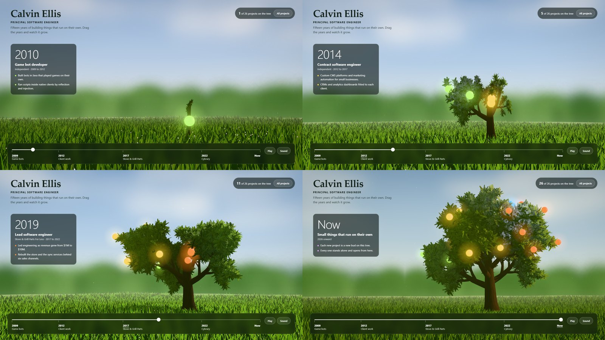

# Career tree prototype

One tree, one slider. Drag the years from 2009 to now and the tree grows from a seedling.
Each job is a side of the tree, each project is a glowing fruit, and the panel on the left
is the work history for the year under the handle. It answers the owner's reference: a
single living object, changed by one control, with real detail.

This is a first working pass in one file. It is not wired into the site.

- [Look at it](#look-at-it)
- [How it works](#how-it-works)
- [What is placeholder](#what-is-placeholder)
- [What it still needs](#what-it-still-needs)
- [Retake the stills](#retake-the-stills)

## Look at it



The scrub from 2009 to now is [shots/scrub.webp](shots/scrub.webp).

To use it, serve this folder and open it.

```bash
python -m http.server 4173 --directory prototypes/career-tree
```

Then open `http://localhost:4173/`. The page loads three.js from a CDN, so it needs a
network connection.

| Control | What it does |
|---|---|
| The slider | Sets the year. The tree, the light and the work history follow |
| The stops under it | Jump to a job |
| Play | Runs 2009 to now in about twenty seconds |
| Sound | Wind |
| Drag the scene | Walk round the tree |
| A fruit | Hover for its name, click for its card |
| All projects | The same projects as a plain list. Picking one turns the tree to face it |

## How it works

- **One number drives everything.** `g` runs from 0 in 2009 to 1 now. Growth, light, the
  camera, the fruit and the words all read it.
- **The tree is a skeleton.** Every branch has a bone at its base and a year it was born.
  Scaling a bone grows its whole subtree, so the young tree is the grown one with most of
  its bones still at zero. Wind is the same bones, turned a little.
- **Leaves ride their twig.** A leaf is skinned to the twig it sits on, so it arrives when
  the twig does. A new leaf opens pale, turns fresh green, then settles.
- **Each job has a side.** Two limbs per job, the oldest lowest. The camera walks round
  as the years pass, so the job under the handle faces the visitor.
- **Fruit rides the wood.** A fruit is placed on the outermost leaf of a twig and follows
  that twig's bone. Before the twig exists it sits where the wood has got to.

## What is placeholder

- Project years, and the copy on every project card.
- The buttons on a card. They open nothing yet.
- The two "small thing" fruits at the top of the tree.

## What it still needs

- **Closer to the reference.** The leaves are drawn, not photographed, and there is no
  depth of field. Real leaf and bark textures and a blur pass are the next step in detail.
- **A frame rate on a phone.** It has only run on a desktop GPU. It draws tens of
  thousands of leaf sprigs and 210,000 grass blades.
- **The real project file**, and a fruit that opens the live thing.
- **The plain page underneath**, reduced motion beyond a calmer wind, and a keyboard path
  to each fruit. The list and the slider are already real controls.

## Retake the stills

```bash
python prototypes/career-tree/shoot.py           # stills and the scrub
python prototypes/career-tree/shoot.py stills    # stills only
```

It needs `playwright` with its Chromium, and `Pillow`. It serves the folder itself, and
waits on real wall time because headless Chrome's virtual time budget skips WebGL frames.
