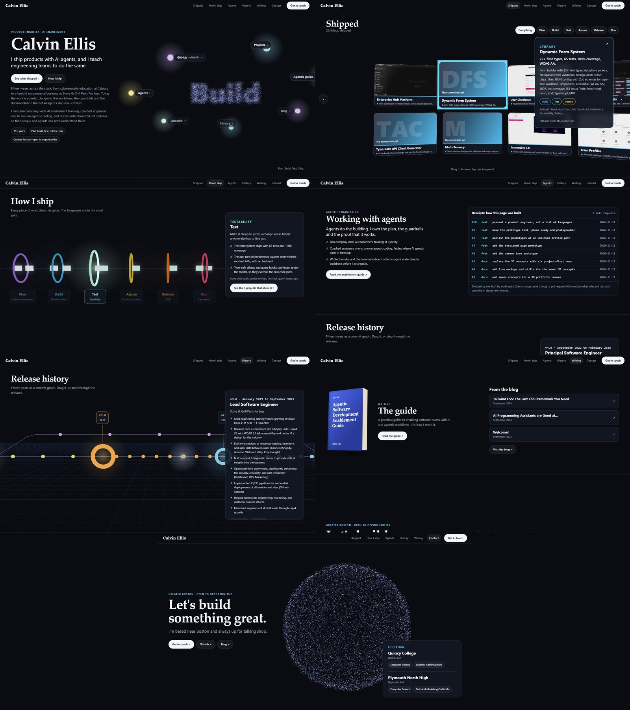
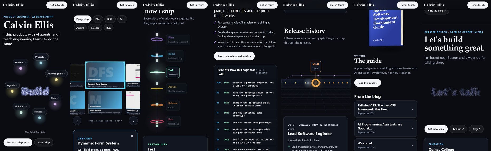

# Sectioned page prototype

One scrolling page that presents a product engineer: what shipped, how it ships, and the
agentic work, with languages in the small print. Each section is its own 3D piece. It
reads the site's own project and work history config, so the content is real. It is a
prototype and is not wired into the site.

- [Look at it](#look-at-it)
- [The sections](#the-sections)
- [The six gates](#the-six-gates)
- [Speed and phones](#speed-and-phones)
- [Layout](#layout)
- [What is real and what is placeholder](#what-is-real-and-what-is-placeholder)
- [What it still needs](#what-it-still-needs)
- [Rebuild and retake](#rebuild-and-retake)

## Look at it





It is live at <https://calvinellis.io/preview/site/>, unlinked and marked `noindex`. That
copy is `public/preview/`, written by `node prototypes/publish.mjs`. Edit the files here,
run that, and the next merge to `main` publishes it. Never edit `public/preview/` by hand.

To run it locally, serve the repo root and open `http://localhost:4173/prototypes/site/`.

```bash
python -m http.server 4173
```

## The sections

| Section | The 3D piece | What you do with it |
|---|---|---|
| About | A swarm of particles with seven bubbles in orbit: four shortcuts to sections and three social links | Left alone it spells plan, build, test, ship. Point at a bubble and it spells that. On a phone it fills the first screen |
| Shipped | A curved wall of the 26 projects, with their screenshots | Drag or use the arrows, filter by gate, open one for its proof, story and links |
| How I ship | Work moving down a line through six gates | Pick a gate for its proof, then send that filter up to the gallery |
| Working with agents | None: words and a log | Read what he does with agents, and the pull requests that built this page |
| Release history | The career as a commit graph | Drag it or step through. Each job is a tagged release with its notes |
| Writing | One book for the guide, drawn in CSS 3D, and the blog's latest posts | Tap the book or a post. Each is a plain link, with no canvas, so it is effortless on a phone |
| Closing | The swarm again, spelling "Let's talk" | Get in touch, and see where he studied |

## The six gates

The page is organised by what a product engineer does, not by language. `build-data.mjs`
holds the model: six gates in the order work moves through them, each with a line on what
it is for, the proof, and the tools.

| Gate | Shows |
|---|---|
| Plan | Project management |
| Build | Maintainability |
| Test | Testability |
| Assure | Quality assurance |
| Release | CI/CD |
| Run | Operations |

- **Every project is filed under the gates it shows**, with one line of proof. A project
  that is not filed fails the build, so a new one cannot be forgotten.
- **Every line of proof is a fact the current site already states.** Nothing is invented.
- **Tools appear last**, as "Built with" on a card and "Done with" under a gate.

## Speed and phones

The first version froze the owner's browser. Measured with headless Chromium on the desktop
GPU, scrolling through every section. The phone profile is a 390 by 844 touch screen with
the CPU slowed four times. It is an emulation, not a real phone.

| Measure | First version | Now |
|---|---|---|
| Desktop: longest main-thread stall | 609 ms | 300 ms |
| Phone profile: longest stall | 2,562 ms | 226 ms |
| Phone profile: stalls in total | 6,163 ms | 1,138 ms |
| Phone profile: lowest frame rate in any section | 16 | 58 |

How it stays quick:

- **No blur pass.** Glows are sprites, and each canvas draws straight to the screen.
- **Three tiers.** `stage.js` picks `low`, `mid` or `high` from the pointer type, screen
  size, core count and memory. `?tier=low` forces one.
- **Sharpness gives way first.** When frames run long for a second or so, a scene lowers
  its resolution a step, and raises it again when frames are quick.
- **A scene starts when it is near and stops when it is off screen.**
- **Small files.** The gallery reads 20 screenshots cut to card size, 274 KB in place of
  4.5 MB, two at a time, decoded off the main thread.
- **Phones.** Below 900 pixels the words and the scene stack. A vertical swipe scrolls the
  page and a sideways one turns the scene.

## Layout

| Path | What it is |
|---|---|
| `index.html` | The page: every section's words and styles |
| `main.js` | Loads the data and starts each scene when its section comes near the screen |
| `stage.js` | One small WebGL stage per section, with the tiers and the resolution trade |
| `hero.js`, `projects.js`, `ship.js`, `releases.js` | One scene each. `hero.js` also draws the closing section |
| `build-data.mjs` | Builds `data.json`: the gates, the projects filed under them, the releases, the receipts, the education and the blog's latest posts |
| `data.json` | The built data, committed so the page runs without a build |
| `assets/` | The gallery's screenshots, written by `../build-assets.py` |
| `shoot.py`, `shots/` | The capture script and its stills |

## What is real and what is placeholder

- **Real:** all 26 projects with their descriptions and links, the proof under each gate,
  the release notes, the 20 screenshots, the social links, the guide, the blog's latest
  posts read from its feed, the education, and the pull requests in the receipts.
- **Filed by hand:** which gates a project shows, its line of proof, and its screenshot,
  all in `build-data.mjs`.
- **Placeholder:** nothing. The shelf of pale placeholder books is gone.

## What it still needs

- The owner's read of each section. They are independent, so any one can be swapped.
- His agentic work. The page says what he does with agents and shows this page's own
  receipts. His private projects are not on it. The ideas for showing them are in
  [the plan](../../plans/3d-portfolio-concepts.md#ideas-for-showing-the-agentic-work).
- A real phone. The phone numbers above come from an emulated one.
- The plain page underneath, and a move into the Next.js app once the sections are chosen.

## Rebuild and retake

```bash
node prototypes/site/build-data.mjs      # after a change to the site's config, or to refresh the receipts and the posts
python prototypes/build-assets.py        # the gallery's screenshots
python prototypes/site/shoot.py          # every section, and the sheet
python prototypes/site/shoot.py phone    # every section as a phone shows it
node prototypes/publish.mjs              # write the copy that the site publishes
```

The capture needs `playwright` with its Chromium, and `Pillow`. It serves the repo root
itself, and waits on real wall time because headless Chrome's virtual time budget skips
WebGL frames.
